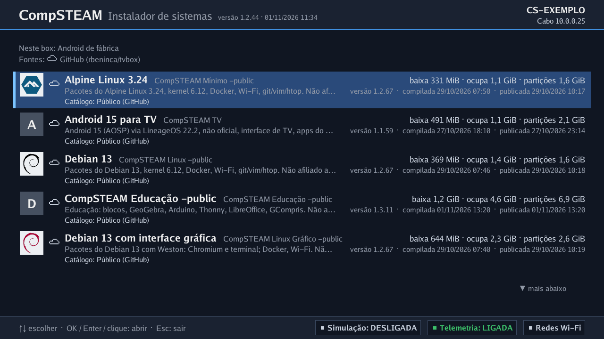
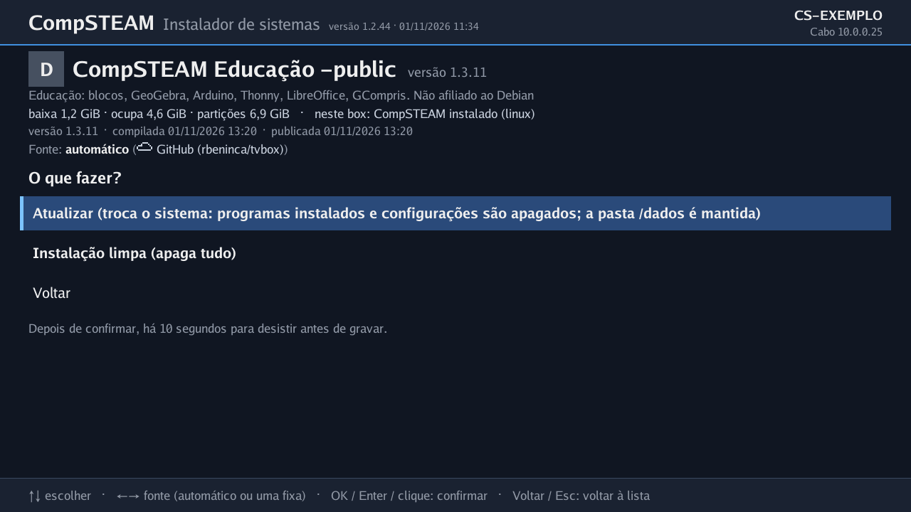
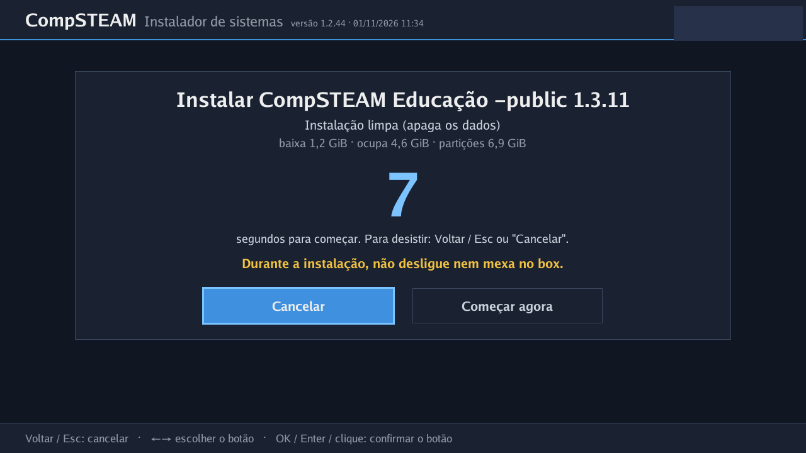
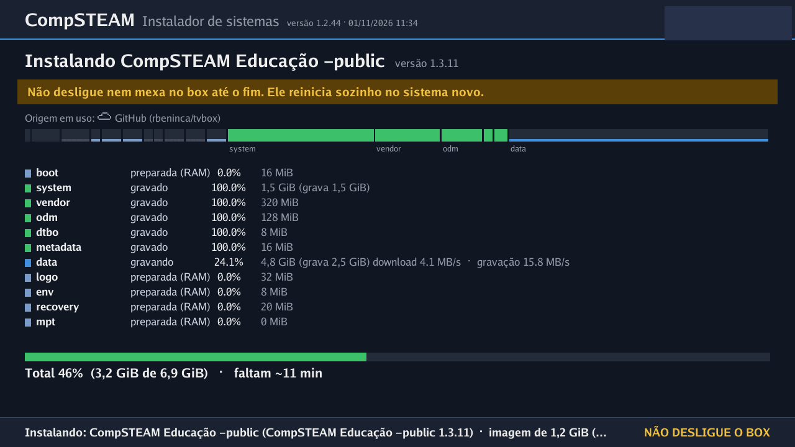

# Como instalar um sistema CompSTEAM num TX9

Instalador público, versão **1.2.62** (release [`instalador-tx9-1.2.62`](https://github.com/rbeninca/tvbox/releases/tag/instalador-tx9-1.2.62)).
Serve para o **TX9 com SoC Amlogic S905W (placa P281)**. O instalador baixa sozinho a imagem escolhida; não baixe à mão.

## O que você precisa

- Um TX9 (ver [hardware.md](hardware.md)).
- Cartão microSD ou pendrive **FAT32**, sem proteção contra escrita.
- Cabo de **rede (Ethernet) com internet** e TV no HDMI.
- Palito ou clipe para o botão reset (no fundo do box).
- Controle remoto, ou teclado e mouse USB.

## Passo a passo

1. **Baixe o zip** `instalador-publico-tx9-1.2.62.zip` na release acima.
   SHA-256: `4f771acd4d725385a00ac3e5180c298b44e54273c4e7632520378eff2a538f1c`.
2. **Descompacte TODOS os arquivos na raiz** do cartão/pendrive (sem criar pasta). Não deixe `aml_autoscript`
   nem `aml_sdc_burn.ini`.
3. Com o box **desligado**: ligue o cabo de rede, a TV no HDMI e coloque o cartão/pendrive no box.
4. **Segure o botão reset** com o palito e **ligue** o box (conecte a fonte). Solte após cerca de 5 segundos.
5. A TV mostra a lista de sistemas. Escolha e confirme.

   

6. Se o box já tem um sistema CompSTEAM, aparece **"O que fazer?"**:
   - **Atualizar**: troca o sistema (programas instalados e configurações são apagados; a pasta `/dados` é mantida);
   - **Instalação limpa**: apaga tudo.

   

   Se a troca **muda o arranjo do disco** (por exemplo, de linha de comando para o Linux Gráfico, que usa a memória toda), só
   há a **"Instalação limpa"**.
7. **10 segundos para desistir.** Após confirmar há uma contagem; **Voltar / Esc** ou **Cancelar** desiste sem gravar nada.
   Depois dela, a instalação **grava a memória do box**.

   

8. **Não desligue nem mexa no box durante a gravação.** A tela mostra o progresso por partição; leva de poucos a cerca de 20
   minutos, conforme sistema e rede (Linux texto, cerca de 2; Linux Gráfico com o kit Educação, 17 a 21 na rede local). O box reinicia sozinho no sistema novo.

   

9. **Tire o cartão/pendrive depois de instalar.** Com ele no box, o instalador do cartão sempre abre.

## Box de fábrica: a pasta `compsteam-reserved`

Num box com o sistema de fábrica, antes de gravar, o instalador **tenta copiar para o cartão a pasta `compsteam-reserved`**: a
identidade do box (partição `reserved`, única de cada aparelho). Se a cópia der certo, guarde essa pasta. Se não der (cartão
protegido contra escrita, por exemplo), o instalador avisa e **instala assim mesmo**.

## Depois da instalação

- **Reset sem cartão** abre o **instalador guardado no box** (partição `recovery`), que também baixa as imagens do GitHub;
  assim se troca de sistema sem cartão.
- O conteúdo baixado é conferido pela assinatura do CompSTEAM; arquivo alterado é recusado.

## O arquivo `compsteam.conf`

Texto simples; `#` comenta. Padrão da versão pública:

```
fonte=github:rbeninca/tvbox   # de onde baixar as imagens (releases do GitHub)
telemetria=on                 # padrão desde a 1.2.47; off = o sistema instalado não envia nada ao painel
registro=instalacao           # só a "batida" de presença no instalador; nenhum = nem isso
# catalogo=publico            # limita a lista às imagens públicas e às do cartão
# wifi_rede=...               # (opcional) rede Wi-Fi para o instalador
```

Telemetria: vem ligada desde a 1.2.47, sem pergunta. O botão **Telemetria**, embaixo da lista, explica o que é enviado e desliga;
`telemetria=off` faz o mesmo antes de ligar o box (no MXQ Pro: `rastreamento=desativado`). Uma escolha anterior é mantida.
`telemetria=sem_agente` instala sem o agente do inventário.

## Se algo der errado

- Sem imagem ou o instalador não abre: confira o cartão (FAT32, arquivos na raiz, sem `aml_autoscript`) e repita o reset.
- Lista vazia: confira a internet do cabo; o instalador tenta o GitHub alguns segundos após a rede subir.
- "Precisa de instalador mais novo" ao lado de um sistema: use o instalador 1.2.44 ou mais novo (o do zip acima).
- Box travado, que nem liga: o modo USB do fabricante (nunca apagado) permite recuperação por cabo com um PC; ver a documentação
  do projeto.

## MXQ Pro

Imagens em [sistemas.md](sistemas.md). O zip do TX9 (`instalador-publico-tx9-1.2.62.zip`) não serve; o MXQ tem o seu: [instalador-mxq-1.2.57](https://github.com/rbeninca/tvbox/releases/tag/instalador-mxq-1.2.57)
(`instalador-publico-mxq-1.2.57.zip`).

1. Confira o `SHA256SUMS` e grave o arquivo `compsteam-mxq-publico-1.2.57.img` num microSD de 1 GB ou mais
   (balenaEtcher, Raspberry Pi Imager ou `dd`). O cartão é apagado.
2. (Opcional) Edite o `compsteam.conf` da unidade `COMPSTEAM` (telemetria, registro).
3. Box desligado, cabo de rede com internet, TV no HDMI. Ponha o cartão no slot microSD e ligue a fonte.
4. Escolha o sistema e confirme. Há 10 s para desistir; depois a instalação grava a memória (NAND).
5. No fim, tire o cartão e ligue o box de novo.

O Wi-Fi do instalador não vem configurado: use o cabo de rede.

A versão 0.2.43 muda as partições e apaga o `/home`: guarde seus arquivos antes.

## BTV11

O zip do TX9 não serve; o BTV11 tem o seu: [instalador-btv11-1.2.57](https://github.com/rbeninca/tvbox/releases/tag/instalador-btv11-1.2.57)
(`instalador-publico-btv11-1.2.57.zip`), para pendrive USB.

1. Pendrive FAT32. Descompacte o zip na raiz, sem pasta. Não deixe `aml_autoscript` nem `emmc_autoscript` no pendrive.
2. Box desligado, cabo de rede com internet, TV no HDMI, pendrive numa porta USB. Ligue o box.
3. Escolha o sistema e confirme. Há 10 s para desistir; depois a instalação grava a memória (eMMC).
4. No fim, tire o pendrive e reinicie o box.
