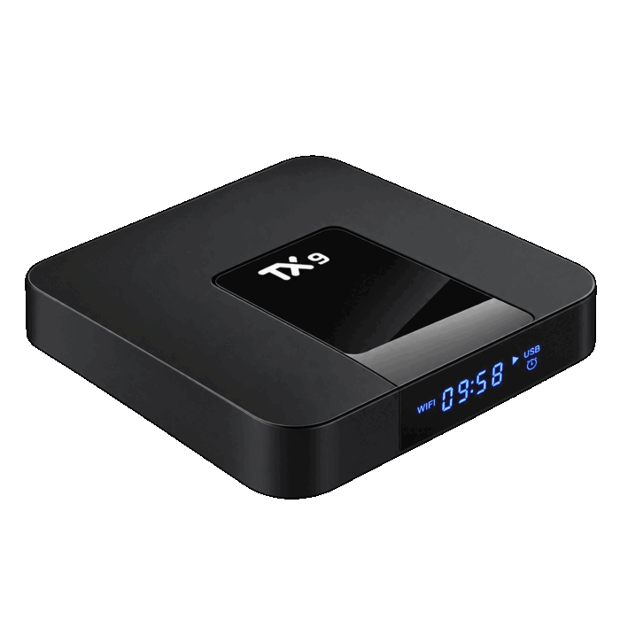
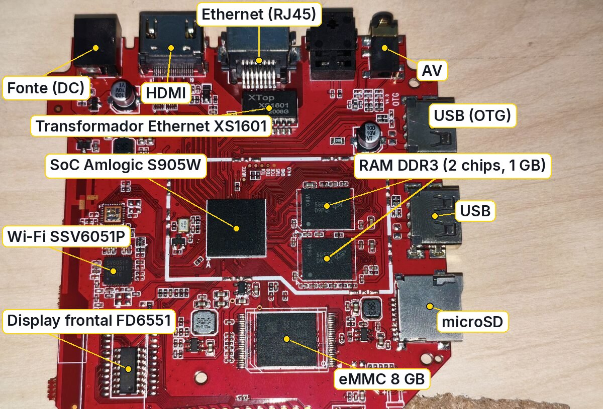
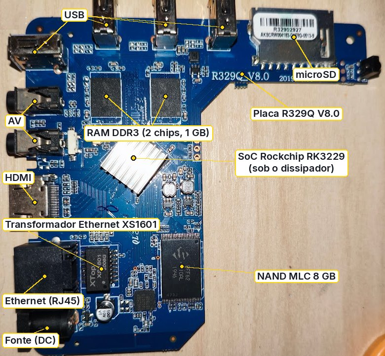

# Hardware suportado

O CompSTEAM tem imagens para três TV boxes (TX9, MXQ Pro e BTV11). O instalador reconhece a placa e só oferece o que serve para ela.

## TX9 (placa P281)

| Item | Valor |
|---|---|
| SoC | Amlogic S905W (família GXL), 4 núcleos Cortex-A53 |
| RAM | 1 GB (o firmware de fábrica anuncia 4 GB, o que é falso) |
| Memória interna | eMMC de 8 GB |
| Wi-Fi | SSV6051 (iComm), **somente 2,4 GHz**, ligado por SDIO |
| Rede cabeada | Ethernet 10/100 |
| Vídeo | HDMI; GPU Mali-450 (só OpenGL ES 2.0) |
| Display frontal | controlador FD6551: 4 dígitos de 7 segmentos e ícones (LAN, Wi-Fi, Play, Pause, relógio, USB) |
| Controle remoto | receptor IR, protocolo NEC estendido, 13 teclas |
| USB | portas USB 2.0; uma delas é a porta OTG usada para gravação por cabo |
| Bluetooth | a placa não tem rádio; funciona com adaptador USB |
| Botão reset | fica no fundo do box (pelo furo, com um palito); é ele que abre o instalador |
| Sistema de fábrica | Android 7.1.2 de 32 bits com kernel 3.14 de 64 bits |

A placa do TX9 vem em revisões diferentes no mercado; o CompSTEAM foi desenvolvido e testado na placa P281 com 1 GB de RAM.
Caixas com o mesmo nome comercial e placa diferente (outra RAM, outro Wi-Fi) não são cobertas.

## MXQ Pro (Rockchip RK3229)

| Item | Valor |
|---|---|
| SoC | Rockchip RK3229, 4 núcleos Cortex-A7 (32 bits) |
| RAM | 1 GB |
| Memória interna | NAND de 8 GB (MLC), acessada por camada de tradução (FTL) |
| Wi-Fi | SSV6006C, somente 2,4 GHz |
| GPU | Mali-400 (3D funciona com o driver livre lima, cerca de 40 quadros por segundo em teste) |
| Observação | muitos boxes desse modelo trazem o mesmo MAC e número de série; o CompSTEAM cria uma identidade própria a partir do número do chip |

Do MXQ Pro existem as variações Debian, Debian com área de trabalho, Alpine e Ubuntu com interface gráfica
(ver [sistemas.md](sistemas.md)). Não há Android CompSTEAM para ele.

## BTV11 (Amlogic S905X3)

| Item | Valor | Estado |
|---|---|---|
| SoC | Amlogic S905X3 (família SM1), 4 núcleos Cortex-A55; placa X3BL46_V2.0 | resolvido |
| RAM | 2 GB | resolvido |
| Memória interna | eMMC de 16 GB (14,6 GiB) | resolvido |
| GPU | Mali-G31, driver livre Panfrost (glmark2 entre 124 e 167) | resolvido |
| Rede cabeada | Ethernet 100 Mbit (PHY interno); 94 Mbit/s medidos | resolvido |
| Wi-Fi | AP6212 (BCM43430), SDIO, 2,4 GHz; Bluetooth no mesmo chip | resolvido |
| Controle IR | receptor IR; o LED de IR pisca com o controle; teclas ainda não testadas | não testado |
| Vídeo HDMI | HDMI; no Android o modo é filtrado pela TV | resolvido |
| Áudio | som pelo HDMI ainda não testado | não testado |
| Display frontal | não tem; só LEDs de estado | n/a |

O BTV11 ainda não tem instalador público; as imagens estão em teste.

## Estado do suporte nos três aparelhos

Resolvido = funciona e foi provado. Parcial = funciona em parte ou há ressalva. Não testado = sem prova registrada.

| Aparelho | IR | Áudio | Wi-Fi |
|---|---|---|---|
| TX9 | resolvido | resolvido | resolvido (SSV6051) |
| MXQ Pro | parcial (falta conferir o mapa de teclas) | resolvido (HDMI e analógico) | resolvido (SSV6006C) |
| BTV11 | não testado | não testado | resolvido (AP6212) |

## O que é igual nos três

- O bootloader de fábrica fica como está; o sistema entra "por trás" dele.
- Um instalador de rede único, gravado numa partição própria (`recovery` no TX9; `instalador` no MXQ).
- Identidade do box derivada do número de série do chip (nunca do MAC, que pode se repetir).

Veja [particoes.md](particoes.md) para o mapa da memória e [dtb-e-drivers.md](dtb-e-drivers.md) para os drivers.
