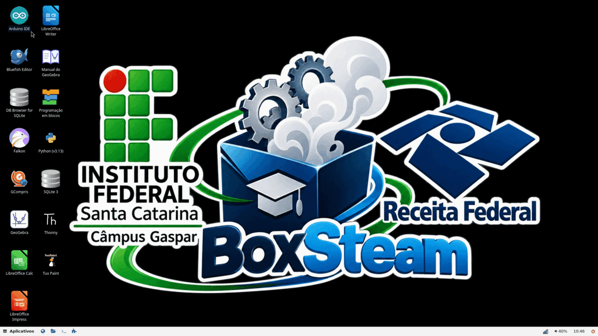
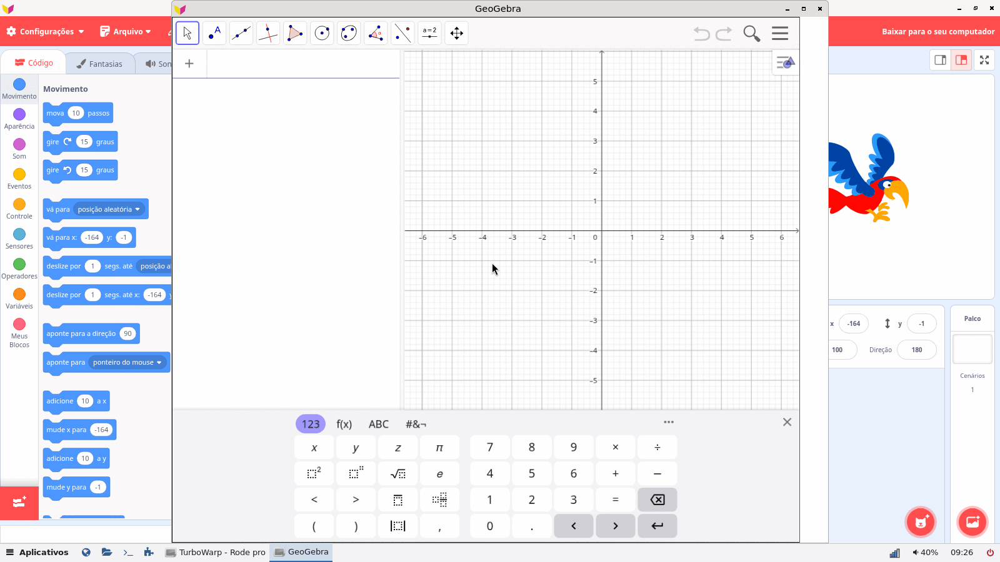

# Sistemas publicados

Todos os sistemas têm base **Linux** ou **Android** e são escolhidos **na TV pelo instalador** (ver [como-instalar.md](como-instalar.md)).
Os arquivos das releases de sistema são baixados pelo instalador, **não à mão**. "Variação do sistema" (nos textos antigos, "spin")
é uma imagem pronta com um conjunto de programas.

## TX9 (Amlogic S905W)

| Sistema (nome na lista) | Para quê | Release |
|---|---|---|
| **Instalador** 1.2.45 (zip para o cartão) | programa que instala os demais | [`instalador-tx9-1.2.45`](https://github.com/rbeninca/tvbox/releases/tag/instalador-tx9-1.2.45) (Latest) |
| **CompSTEAM Educação** 1.3.12 (Debian 13) | blocos/TurboWarp, GeoGebra offline, Arduino IDE, Thonny, LibreOffice, GCompris; **precisa do instalador 1.2.44 ou mais novo** (usa a memória toda do box) | [`debian-educacao-gui-1.3.12`](https://github.com/rbeninca/tvbox/releases/tag/debian-educacao-gui-1.3.12) |
| **Área de Trabalho** 1.2.69 (Debian 13, labwc) | área de trabalho leve, com painel, navegador e gerenciador de arquivos | [`debian-labwc-gui-1.2.69`](https://github.com/rbeninca/tvbox/releases/tag/debian-labwc-gui-1.2.69) |
| **Linux Gráfico** 1.2.69 (Debian 13, Weston) | Chromium e terminal | [`debian-gui-1.2.69`](https://github.com/rbeninca/tvbox/releases/tag/debian-gui-1.2.69) |
| **Linux** 1.2.69 (Debian 13) | linha de comando, com Docker | [`debian-1.2.69`](https://github.com/rbeninca/tvbox/releases/tag/debian-1.2.69) |
| **Mínimo** 1.2.70 (Alpine Linux) | linha de comando, o menor possível, com Docker | [`alpine-1.2.70`](https://github.com/rbeninca/tvbox/releases/tag/alpine-1.2.70) |

Todas as variações de Linux trazem Docker, Wi-Fi, git, vim, htop, controle IR, áudio e display frontal funcionando.
O Android CompSTEAM TV (LineageOS 22.2) não consta como release pública nesta lista.

## MXQ Pro (Rockchip RK3229)

| Sistema | Release |
|---|---|
| **Instalador** 1.2.45 (imagem para o cartão microSD) | [`instalador-mxq-1.2.45`](https://github.com/rbeninca/tvbox/releases/tag/instalador-mxq-1.2.45) |
| Área de trabalho leve (labwc) | [`mxqpro-debian-labwc-gui-0.2.39`](https://github.com/rbeninca/tvbox/releases/tag/mxqpro-debian-labwc-gui-0.2.39) |
| Debian com área de trabalho | [`mxqpro-debian-gui-0.2.39`](https://github.com/rbeninca/tvbox/releases/tag/mxqpro-debian-gui-0.2.39) |
| Debian (linha de comando) | [`mxqpro-debian-0.2.39`](https://github.com/rbeninca/tvbox/releases/tag/mxqpro-debian-0.2.39) |
| Alpine (mínimo) | [`mxqpro-alpine-0.2.39`](https://github.com/rbeninca/tvbox/releases/tag/mxqpro-alpine-0.2.39) |
| Ubuntu com interface gráfica | [`mxqpro-ubuntu-gui-0.2.20`](https://github.com/rbeninca/tvbox/releases/tag/mxqpro-ubuntu-gui-0.2.20) |

## Canais usados pelo instalador

Não são para baixar à mão; o instalador os lê sozinho.

| Canal | Função |
|---|---|
| [`catalogo`](https://github.com/rbeninca/tvbox/releases/tag/catalogo) | lista assinada das imagens disponíveis |
| [`instalador-publico`](https://github.com/rbeninca/tvbox/releases/tag/instalador-publico) | versão do instalador guardado no box, para atualização |

## CompSTEAM Educação em detalhe

- **Programação em blocos** (TurboWarp, compatível com Scratch) e **GeoGebra Classic** funcionam **sem internet**; há um manual do
  GeoGebra em português.
- **Arduino IDE** (com exemplos), **Thonny** e Python 3, **LibreOffice** (Writer, Calc, Impress), **GCompris**, **Tux Paint**,
  **SQLite** e **DB Browser for SQLite**, editor **Bluefish** e o navegador Falkon.
- Raiz grande (perfil 5b, ver [particoes.md](particoes.md)): baixa cerca de 1,2 GiB e ocupa cerca de 4,6 GiB; usa a memória toda do box.
- O WebGL do navegador usa renderização por software nas janelas locais (ver [dtb-e-drivers.md](dtb-e-drivers.md)).

